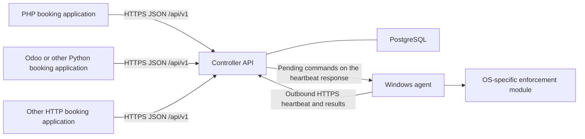

# Architecture

The Universal Gaming PC Agent Platform coordinates authorized gaming-PC
sessions. Booking applications remain the systems of record for customers,
payments, bookings, and business rules. They request sessions from one
controller API. A Windows agent on each gaming PC reports connectivity and
command results, and can enforce local access when the operator enables that
mode.

## Components

### A. Booking application

A booking application owns bookings, customer accounts, payment, and business
rules. It requests an authorized session for a device it is allowed to use,
then polls until the controller records an agent result.

It does not need Windows or Linux internals. It does not open a connection to
an agent. It does not share its database with the controller. Its booking id
travels in `external_reference`.

The same JSON contract serves PHP, Odoo/Python, and any other HTTP client. See
[INTEGRATION.md](INTEGRATION.md).

### B. Controller and API

The controller is the coordination component. One codebase and one `/api/v1`
contract serve cloud and on-premise deployments.

It is responsible for:

- Device registration and device identity.
- Authenticating API clients and agents as different identities.
- Validating session-control requests against the caller's account.
- Creating and tracking commands.
- Tracking session and device status.
- Recording command results.
- Offering each command to the agent registered for that device.
- Applying per-account booking API rate limits.

PostgreSQL stores devices, registration idempotency, list cursors, sessions,
session commands (including start, extend, and end), agent certificate
fingerprints, and rate-limit windows. The database is behind the controller.
It is not an integration interface.

Controller acceptance stores a session and a command. `outcome: accepted`
means that record exists. `start_confirmed` and `lock_confirmed` become true
only after the agent result rules in
[../contracts/session-lifecycle.md](../contracts/session-lifecycle.md) are met.

### C. Windows agent

The Windows agent identifies the device, maintains an outbound HTTPS
conversation with the controller, validates authorized commands, and reports
results. Local deadline persistence and restart recovery are part of the agent
runtime when configured by the operator.

The transport is request/response HTTPS. `POST /api/v1/agents/heartbeat`
carries the agent's status and command results. The response carries pending
commands for that device. Booking applications do not use the heartbeat
operation.

### D. OS-specific enforcement module

| Portable core | OS enforcement module |
| --- | --- |
| Identity, heartbeat, command checks, and idempotency | Lock and unlock, or the platform equivalent |
| Session and command vocabulary shared with the controller | Windows implementation first |
| Reports `locked`, `playing`, or `unknown` | Produces those states by OS-specific means |

Enforcement stays off until the operator enables it for a controlled test or
production policy. Documentation of unfinished installer work is in
[../guides/WINDOWS-AGENT.md](../guides/WINDOWS-AGENT.md).

### E. Deployment boundary

Cloud hosting and on-premise hosting run the same controller application and
the same OpenAPI contract. The deployment changes the host name, the TLS
certificate, and the network path. It does not change paths, schemas, or
session states. Networking for both arrangements is in
[deployment-models.md](deployment-models.md).

A local network is a different trust environment from a public cloud network.
Both require TLS and the identities in [security-model.md](security-model.md).
Presence on a LAN does not authorize a caller.

## Session-command sequence

1. Booking app creates a session (`POST /sessions`) → HTTP 202 `accepted`.
2. Agent heartbeats and receives `start_session` in `pending_commands`.
3. Agent acknowledges and later reports execution / verified effect.
4. Booking app polls `GET /sessions/{id}` until `start_confirmed` or a
   terminal state.
5. Extend and end follow the same accept-then-confirm pattern.

## What this document is not

- Not a claim of production certification.
- Not a substitute for [../api/openapi.yaml](../api/openapi.yaml).
- Not a distribution of controller or agent source code.
