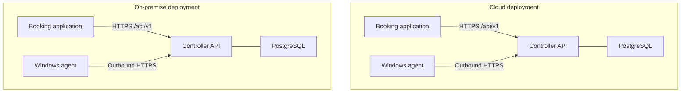

# Deployment models

Cloud and on-premise installations use one controller application and the contract in `api/openapi.yaml`. They are two placements of that application, not two products and not two APIs.

The URL template is:

```text
https://{controllerHost}/api/v1
```

`controllerHost` is the only deployment-specific part of the public URL. Paths, methods, schemas, enums, and session rules stay the same.



## Cloud

- The controller is published at a hostname the booking application and the agents can reach.
- Booking applications call that host over HTTPS.
- Each agent opens an outbound HTTPS connection to that host. The gaming PC does not listen for controller connections.
- PostgreSQL is reachable from the controller and is not an integration endpoint.
- The booking application's own hosting, including any Odoo hosting model, is outside this platform. Only HTTPS to the controller is required.

## On-premise

- The same controller application runs on a server at the site.
- The hostname may be local DNS. The paths remain `/api/v1/...`.
- Booking software on the site, or at a remote site that can route to the controller, uses the same requests as a cloud caller.
- Agents still initiate outbound HTTPS to the local controller. Firewall rules allow that egress. They do not publish agent ports.
- TLS is required on the local network. A private certificate authority is acceptable. Skipping authentication because the caller is on the LAN is not acceptable.

## What does not change between deployments

| Item | Cloud | On-premise |
| --- | --- | --- |
| API paths and schemas | `/api/v1` | `/api/v1` |
| Booking client authentication | OAuth 2.0 client credentials over TLS | OAuth 2.0 client credentials over TLS |
| Agent authentication | Device mTLS, as proposed | Device mTLS, as proposed |
| Session and command states | This specification | This specification |
| Who initiates the agent connection | The agent | The agent |

Rate limits, certificate issuance, and backup policy may differ by deployment. Those differences are operational. They must not produce a second API.

## Trust

A cloud network and a local network are different trust environments. In both, the controller authenticates the caller, authorizes the account, and encrypts the transport. Shared network location is not a credential.

## Not in this task

This document does not add container manifests, cloud templates, database clusters, or a second controller codebase.
